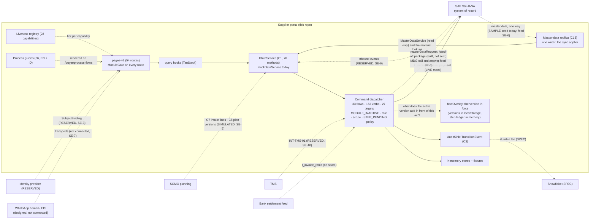

# Architecture — the portal in the federated landscape

**Status:** v3 · 2026-10-13 · written read-only from `main` @ `aac5f8588d55e851d0d530e3454ee1f4b649137c` (the merge commit of PR #439, MD-4 + MD-5; this file was first written and fact-checked at `3021f3d6…`, the merge of PR #438, and then re-pinned). v2 of this file was pinned at `166a5611…` (PR #418) and tagged `handover-v2` at `b0f9a97b` on 2026-10-09; v1 is the tag `handover-v1` (`9cc535b`). PRs #420–#439 have merged since the v2 tag (ADM-1, UI-1a to UI-1e, PG-1 to PG-3, FB-1 to FB-4, MD-1, MD-2, MD-2b, MD-4 + MD-5). `CHANGES_SINCE_V2.md` says what a reader of v2 must unlearn; `SE_BACKLOG_v3.md` holds what was left open. **What moved in this file:** the Flow Builder line of §5 (reversed), two new architecture notes in §3 (the process-change overlay; the master-data replica, C13), the C9 paragraph, the S/4HANA row of §1, and the figures in the diagram. **At the re-pin (PR #439):** the C13 paragraph of §3 (change requests; what "never writes" means now), the portal and S/4HANA rows of §1, one edge and the figures in the diagram, and one line of §5.
**Tiers used below** (from `docs/contracts/README.md`): **LIVE** = code exists and runs (mock or in-memory); **RESERVED** = a named swap-point with no implementation; **SPEC** = a build target with zero code. The SE package that owns each integration is named (D1 §4).

---

## 1 · The systems

| System | Role | What the portal exchanges with it | Status in the tree | SE package |
|---|---|---|---|---|
| **Supplier portal (this repo)** | collaboration and orchestration layer; owns confirmations, declarations, uploads, reviews, forecast publications to suppliers, module activation, changes to a process (versions) and the steps they add, its own proposals to change SAP's master data (change requests), the audit trail | — | LIVE on fixtures | SE-4 |
| **SAP S/4HANA** | system of record for PO, GR, invoice, contract, scheduling agreement, vendor master, material master; owns the verbs the portal never fires | outbound: settlement of `t_gr_post` and `t_invoice_release_payment`; inbound: business events; inbound, one way: master data into the portal's replica (C13); outbound, as a package only: an agreed master-data change request, with SAP's answer coming back (C13 §8) | outbound boundary LIVE (mock `settle`); inbound RESERVED, no seam code (C12 §5); document numbers never minted in the portal (C11 V15, gated); the master-data replica is LIVE on two SAMPLE seed runs, with no feed (the `masterData` capability is SIMULATED); the change-request flow is LIVE in memory and stops at the hand-off package — nothing is sent, and the only answer that can be recorded is one marked as a sample, on a demo or preview deployment | SE-6, SE-12 |
| **SOMO (planning)** | emits demand, accepted requirements, plan versions, reorder point and safety stock | C7 intake lines → `intakeLine` machine → `t_pr_create`; C8 plan versions → `forecastPublication` machine → supplier responses; C9 material crosswalk | intake and publication machines LIVE on SIMULATED feeds (`src/services/planning/somoFixture.ts`, `src/services/data/mock/publicationFeed.ts`); `rop` / `safetyStock` / `projectedStock` SPEC (no producer); C9 zero rows | SE-5 |
| **TMS (transport)** | owns the shipment and ASN movement facts | `INT-TMS-01` ASN boundary | RESERVED (C5); `shipment` flow unwired | SE-10 |
| **Snowflake** | analytical layer | tee of the durable audit sink; curated datasets | SPEC (C4), zero code | not in the 23 packages |
| **Bank / settlement feed** | owns `t_invoice_remit` | — | no seam code (C12 §5) | SE-6 |
| **Messaging (WhatsApp BSP, email, EDI)** | supplier channels | outbound requests, inbound replies, reminders | every channel "Designed … (not connected)" (`src/data/communicationProfiles.ts`); an operator-fed inbound simulator at `/supplier/comm-hub`; no scheduler | SE-7, SE-19 |
| **Identity provider** | authenticates Paragon staff (Entra); supplier IdP unprocured (D-ID-2) | a `SubjectBinding` per person, nothing else | RESERVED (C5, C10) | SE-3 |
| **Object storage** | uploaded documents | file bytes behind `supplierDocument` | nothing stores bytes today | SE-8 |

**Two readings from the source documents, recorded as input rather than as fact.** The RFP Coverage Matrix v2 reads the landscape as hub-and-spoke on Snowflake; the tree does not implement it (C4 SPEC) and no contract ratifies it. The SE Handoff v1 names S/4 OData surfaces and a stack; none is referenced in the repository, and the Build Plan's FORK-6 leaves the stack to the SE Team. Both are open in D6.

## 2 · Diagram (Mermaid source)

---

## 3 · The seams, one paragraph each

**C5 — the seam register (`docs/contracts/C5-seams.md`).** The swap-points where the mock becomes the real system. `IDataService` behind `DataServiceContext.tsx` is LIVE (mock); `httpDataService` is RESERVED; `ICommandService` is LIVE in-memory; the SAP Option-B boundary is LIVE for two verbs; `AuditSink` is LIVE in-memory with the durable sink RESERVED; OIDC and `INT-TMS-01` are RESERVED; the backend datastore is RESERVED; Snowflake is SPEC. The two rows v1 reported wrong were corrected at H1 (2026-10-02), each quoting the old text: LivenessRegistry now reads "LIVE (in-memory)" (`C5-seams.md:26`, `:143`) and the OIDC swap-point reads the seat's `businessRoles` resolved by `atomsForSeat` (`:22`). Still missing at the pin: rows for the read sub-services `IPlanningService`, `IModuleService` and (new) `IMasterDataService`, and for the dispatcher's `flowOverlay` dependency (`grep -i -c -E "planning|module|master|overlay" docs/contracts/C5-seams.md` returns 0 at this pin). Since the v2 tag C5 changed in one line only: `httpDataService` implements "all 76 methods" (it read 72). D8 says which corrections stand open. Pinned by `pinReach.contract.test.ts` for its cited files, not for the tier column.

**C7 — purchase-requisition intake (`C7-pr-intake.md`, Amendment 1 2026-09-28).** One intake shape for two producers (the planning grid and SOMO). Since A2 an intake line is a machine: `intakeLine` (`Pending → Dismissed / Committed`, `t_intake_dismiss` / `_restore` / `_commit`; the atom is `intake:triage`, held by the planning lane, since PLN-3 — v1 said `pr:create`); commit cascades to `t_pr_create` with the line id as idempotency key, and `Committed` is terminal. The requisition carries its origin (`intakeLineId`, `periodBucket`, `decision`); the bucket is `month` or ISO `week` (`src/services/planning/bucket.ts`), quarters refused. `wasAdjusted` is derived by the dispatcher (`dispatcher.ts`, the block headed "THE DERIVED DECISION (A1-R2a)"; v2 cited `:492-495`, which has moved) from the producer's baseline and is not a key any caller has. C7-FIND-02 and C7-FIND-05 are closed at A2; C7-FIND-03 (`shortfall`) stays open, pinned by `ledgerTruth.test.ts`. The self-contradiction v1 reported on C7-FIND-02 was corrected at H1 (`C7-pr-intake.md:464-467`). **New since v1:** Amendment 2 (2026-10-02) records who commits (planning triages, the cascade raises the requisition, procurement approves), one intake population (the queue lists every line the grid commits; Intake Review is a view of the plan grid) and `INTAKE_ONE_GRAIN` (one material × period commits at most once across grains; raw materials are planned monthly, packaging weekly). Amendment 3 (2026-10-05) records what a committed requisition carries (`category`, `requestorRole`) and the bulk acts. The intake line carries an optional `unitPrice` (IDR per unit) and a requisition is priced `unitPrice ×` the committed quantity (PLN-1, operator ruling).

**C8 — forecast publication (`C8-forecast-publication.md`, Amendment 1 2026-09-28).** The publication is a machine since B4a: `forecastPublication` (`Draft → Published → Superseded / Withdrawn`, and since SDC-5 `Draft → Discarded`; `open`, `allocate`, `approve_firm`, `publish`, `discard`, cascade `supersede`, `withdraw`); a revision is a new publication. Since SDC-1 (#400) there is one current publication **per grain**: a weekly publish supersedes only the weekly plan, both seats keep the monthly plan and its open responses, and a withdrawal brings nothing back. `t_publication_withdraw` has no caller on any surface (`SE_BACKLOG_v3.md`). Planners publish from `/buyer/plan-grid` (`PublicationPanel`, `PublicationLedger`); suppliers see deadline, version banner, net change against the superseded publication, and a dated receipt on `/supplier/forecasts`. Firm lines are signed under `publication:approve` (procurement) by a named actor. The `commitmentClass` projection is still UNRATIFIED: Amendment 1 says outright that it does not ratify it, and the period-global default (first bucket `firm`, later buckets `semi-firm`) is a policy default (`commitmentClassFor`, `src/services/sdc/publication.ts:41-42`); C8-FIND-03's void `locked → firm` mapping is still flagged in `src/services/sdc/types.ts:23`. The plan-version feed is SIMULATED; the supplier read is LIVE-only by construction and shows the sample only when asked for it by name.

**The planning fact seam (`IPlanningService.getPlanningFacts`, B1; C6 governs).** Long-form facts (`materialCode`, `supplierId`, `periodBucket`, `measureId`, `value`, `uom`, provenance) over 15 registered measures (`src/services/planning/measures.ts`); `value: null` means "no figure", never zero. Two measures are editable: `acceptedQty` (through `t_intake_commit`) and `allocation` (through `t_publication_allocate`). C6 Amendment 1 / 1a (2026-09-28) moved the override baseline to the producer and made `wasAdjusted` derived; A1-R4 allows per-seat view state to persist while plan state never persists in the browser.

**Module activation (`IModuleService`, M1).** `getModuleActivation` (every seat; what is ON, derived from the ledger, no attribution) and `getModuleLedger` (buyer only; the acts with who and why). The verb is `t_module_set` (atom `module:set`, compliance lane). No contract document covers this seam beyond C1's method list; Design 5 Part A is its specification.

**The process-change overlay (new; no contract document beyond C1 and C3 — the guides `flowVersion` and `processStep` are the specification, and `docs/designs/DESIGN_6_v2.md`, committed with v3, is the design).** A change to a process is a **version**: a document listing additions to one existing process — steps in front of acts the process already has. It cannot name a state, re-route an act, move a lane or drop a check, so an active version can add a refusal and can never remove one. The version has its own machine (`flowVersion`: `Draft → In Review → Approved → Active → Retired`, or `Rejected`), held by the compliance lane; the approver may not be the proposer, and activation is a separate act from approval. **Architecture note:** nothing is registered. The dispatcher (`createDispatcher`) takes one optional dependency, `flowOverlay`; where it is injected, the dispatcher resolves the act through the one registry as before and then asks the overlay what the version in force adds. A step that is due refuses the act `STEP_PENDING` (a new member of the closed refusal list, after `MISSING_FIELDS`); a step is completed or declined on the `processStep` ledger by the lane the step names; when the act succeeds the completions are spent; and every event carries `flowVersion` (`<entity>@<version>`, C3). Retiring the active version returns the process to the shipped default at once; a version whose process moved is set aside by name. Versions live in `localStorage['paragon.flowVersions']` and are not behind `IDataService` (no read method exists for them on the service surface, C1); step records are in memory. The backend replaces both stores and runs the same overlay on the server (SE-4, SE-16). Not built: forks, checks and scans; supplier-side steps; export of a version. A change to the *shape* of a machine stays generated, reviewed code (`docs/designs/DESIGN_6_FLOW_BUILDER.md` §7).

**C13 — the master-data replica (`docs/contracts/C13-master-data.md`, authored at MD-1, 2026-10-12; the design set behind it is `docs/designs/MASTER_DATA_DESIGN.md`, `MD_BUILD_PLAN.md` and `MD_OPEN_DECISIONS.md`, committed with v3).** SAP S/4HANA is the system of record for master data; the portal holds a replica: it displays the records, keeps them in sync and, since MD-4 + MD-5 (#439), **proposes** changes (C13 §1). **v3's first draft said here:** *"the portal holds a replica it displays and never writes"*. **Stated precisely at this pin:** no portal verb, page or service writes a replicated field, and no act of the change-request flow writes a master record. The replica changes only when a sync run is applied by the one writer. Since #439 that writer has three callers, a named set held by `replicaOneWriter.test.ts`: its own module (the seed), the sample SAP answer (`masterDataRequestTarget.ts`) and the prepared sample sync (`sampleSync.ts`). The last two follow a person's act on a demo or preview deployment, each arrives as a run of its own stamped `SAMPLE` (`SAMPLE-ANSWER-<request number>`, `SAMPLE-SYNC-0001`), and both are refused on production. Three rules bind every implementation: one direction (SAP → portal), SAP wins (an inbound record replaces the replica record whole; no field-level merge), and one writer (the sync applier, `applySyncRun`, held by `replicaOneWriter.test.ts`). Objects: `material`, `supplier`, and eleven reference tables (units, material types and groups, incoterms, payment terms, currencies, countries, plants, storage locations, cost centres, brands). Every record carries a stamp (`source` `SAP_S4` or `SAMPLE`, `readAt`, `sourceChangedAt`, `syncRun`, `sapStatus`, `missingFromRun`), and every surface that shows a record shows the stamp; freshness is computed at read, never stored, and a stale record warns and does not refuse. A sync run is idempotent on its id; a `FULL` run marks what it did not carry and deletes nothing. The read seam is `IMasterDataService` (`list`, `get`, `whereUsed`, `syncLog`; C1 Axis 1): a buyer reads everything; a supplier reads its own supplier record and the reference tables, and another supplier's key answers `null` exactly as an absent key does. **Architecture note:** since MD-2 the rest of the tree reads through it — the material lookups default to `materialMasterView()` (SAP's fields from the replica with the two portal annotations, halal and BPOM applicability, beside them), reference values have a synchronous lookup (`services/masterData/lookup.ts`), and form pickers read their reference table. `src/lib/masterDataGate/` names what still reads a fixture directly (the readers of the supplier fixture, and the category vocabularies). Every record in the fixture is `SAMPLE`; the store and the log are in memory. The feed from S/4HANA is SE-6, the durable store SE-4. **Change requests (C13 §8, MD-4 + MD-5, #439; the guide `masterDataRequest` is the operator's description).** One flow, `masterDataRequest`: `Proposed → In Review → Approved → Sent to SAP → Completed in SAP` or `Declined by SAP`, with return (`In Review → Proposed`), `Rejected` and `Withdrawn`; eight states, nine acts, four endings. Three kinds: `material.create` (every field and no key: SAP gives the key), `material.change`, `supplier.change`. Procurement and planning propose (`masterdata:propose`); planning reviews materials and compliance reviews suppliers (`masterdata:review`, with a hook that holds each lane to its own kind); procurement hands off and records SAP's answer (`masterdata:handoff`, `masterdata:record-sap-answer`). Every act names a person; the person who decides is not the person who proposed, and a Super Admin passes that one check with a recorded reason while an Admin does not. SAP wins here too: a request whose proposed field a sync run has moved cannot be agreed or sent (`MDR_SAP_CHANGED_FIRST`); it is withdrawn and proposed again. **Approved is not exists:** hand-off builds a package — the request number (SAP's external reference and the feed's idempotency key), the kind, the proposed fields, the reason, who proposed and who agreed, and the base it was written against — and stops, because SAP is not connected. `readScopeOwner` is null, so a supplier scope is refused at scope. Requests are in memory for the session (`masterDataRequestStore.ts`) and are dispatched through `ICommandService`, not read through `IMasterDataService`. For the SE Team: the call to SAP MDG at hand-off and the feed that fires the two answer verbs under the automation grant (SE-6); the durable store (SE-4). Not in the contract and not built: purchasing info records and source lists, supplier × material views, indirect materials and services as a class, and a supplier's own read of the materials it is party to. Not built, by ruling (C13 §8): the earlier material-request lane is not folded into this flow, an approved supplier application does not raise a request, a blocked or deletion-flagged record does not yet refuse new documents, and requests are not persisted. MD-3 (supplier × material) and MD-6 (the supplier-proposed catalogue) are on the SE list (PR #439). *C13 §9's closing paragraph still counts "change requests" among what is not built; §8 overtakes it (D8 §11).*

**C9 — material master crosswalk.** Schema and types only: zero rows, zero consumers; thirteen self-declared non-conformances, twelve open. Ratification is SOMO's. The contract is unchanged since v1. **v2 said here:** *"The material master is the frozen `MATERIAL_MASTER` (`src/services/sdc/fixtures.ts:135`, 42 codes) … since SDC-5 the collaboration lane resolves a published line's material in the master it was published from (`src/services/planning/publishedMaterial.ts`) … those codes are **not** added to `MATERIAL_MASTER`"*. **That is overtaken.** There is one master, and it is the replica (the C13 paragraph above): `MATERIAL_MASTER` (`src/services/sdc/fixtures.ts`) is now the seed the replica's first run is built from, the generated sample materials and suppliers are replica records delivered by a second seed run, and `publishedMaterial.ts` is deleted (MD-2b, #437). A record is a generated sample by the run that delivered it (`isSampleMaterial`), never by a prefix on its code; sample materials are still marked on screen (`SampleMaterialTag`). C13 §2 keeps C9's rule that a key is opaque.

**C10 — identity, authority and approval.** Amendment 1 (2026-09-24) plus an errata of 2026-10-02 (H1): the header, §8.4 and §8.5 are corrected as "corrections of fact … not yet ratified", each quoting the old text; the blob at the pin is `6725fa586c8fa7b0f5c4e749e6741611d1aaff6f` (v1 cited `42e23239…`). Amendment 1 discharged §8.2 and §8.3 in code and closed §8.6; §6.3a governs sample persons. Still open: §8.1 (the six-object model is unbuilt), §8.7, §8.8, D-ID-2, D-ID-5. Still stale at the pin: the §2.4 table rows that call PR approval and invoice approval unreachable from any screen (`C10-identity.md:172-173`); both have had surfaces for weeks, and invoice approval now records who approved (OPS-1). No test pins C10.

**Sourcing events (no contract document beyond C1; the guides `rfq`, `quotation` and `stageResponse` are the specification).** One event moves RFI → RFP → RFQ (`RFQ.stage`; absent means RFQ). The wizard chooses the start stage. At RFI the buyer may set a questionnaire on the draft (`t_rfq_questionnaire_set`); at RFP weighted criteria that sum to 100 (`t_rfq_criteria_set`). A supplier answers a stage through the `stageResponse` flow (`Draft → Submitted`; save, re-save, send, or submit in one act). The buyer closes bidding (`t_rfq_close`, a person's act), scores each proposal as a whole sheet (`t_rfq_proposal_score`, atom `rfq:evaluate`), advances with a shortlist of the suppliers who answered (`t_rfq_advance`) or concludes without an award (`t_rfq_conclude`, terminal `Concluded`), and awards only at the RFQ stage. Who has responded is derived at read from the quotations (`src/data/rfqResponses.ts`), never stored. A supplier's read of an event is an allowlist projection (`src/services/data/rfqSupplierView.ts`): it carries the criteria and their weights and never the scores, the knock-out answers or another supplier's id. Not built: exports, blind scoring, templates beyond one browser, inviting a supplier to a published event, any notification.

**The invoice match (the `invoice` and `invoiceMatch` guides are the specification).** Since OPS-1 an invoice is `Matched` only while its amount fits inside what was received and accepted on its purchase order, less what earlier invoices on that order already claim, at the order's own unit prices and with a tolerance of 1% of the ordered value. The match runs when a receipt posts, when an invoice is submitted and when a dispute is resolved. The store stamps `approvedBy` and `releasedBy` from the session. Since E2E-2 (#418) an invoice made from the form states lines at the order's prices, each up to the accepted quantity, and its amount must equal the lines' total; the match still compares totals and does not read the lines. What an order has received is one read, `src/services/data/orderReceipt.ts`, which uses the match's own receipt states and allocation, so the order page, the invoice form and the match cannot disagree. The `invoiceMatch` flow is still a rolled-up sub-flow with no target of its own.

**C11 — invariant pointer.** V15 (the portal never mints a document identity) is now `GATE`, enforced by `src/lib/documentNumberGate/documentNumberGate.test.ts` (PR #392). V16 and V17 remain `NOT ENFORCED`.

**C12 — the backend spec.** A map of what is absent per seam, the never-build rules, inherited invariants, the idempotency contract and the seam-code gap. §2.1's V15 paragraph was rewritten at #392 ("used to violate … retired … gated"). The §1 sentence v1 reported false ("C3 has no pin and no reader") was corrected at H1 (`C12-backend-spec.md:47` now names `c3Events.contract.test.ts`).

---

## 4 · Data flow for one act (what the backend reproduces)

A planner commits an accepted quantity from the planning grid:

1. `PlanGrid` / `TimePhasedGrid` (`src/pages-v2/plan-grid/`) holds the typed or pasted value in a PLANNED overlay (React state, `PlanDraftProvider.tsx`); a reason is required when it differs from the producer's baseline.
2. Push calls `useIntakeCommit` (`src/services/query/commandHooks.ts`) once per row; the first dispatch's `correlationId` becomes the `causationId` of the rest. Since PLN-4 a push of many rows refreshes the planning read once at the end, not once per row, and reports progress row by row.
3. The dispatcher checks tenancy first (a thrown `SCOPE_DENIED` / `NOT_FOUND`), then the module (`PLN` for the intake line; `REQ` again for the cascaded create; `flows: ['intakeLine']` in the `PLN` entry of `src/services/modules/registry.ts`), the seat's atom (`intake:triage`; the cascaded create runs under the automation grant), `expectedState`, legality (`Pending`), payload attribution keys, required fields, then the `INTAKE_*` hooks (including `INTAKE_ONE_GRAIN`), and derives `decision.wasAdjusted`.
4. `intakeLineTarget` marks the line `Committed`; the cascade dispatches `t_pr_create` with `idempotencyKey = line.id`, and the requisition store mints the requisition with its origin.
5. Two `TransitionEvent`s are emitted (the commit and the cascaded create), linked by `causationId`.
6. The hook invalidates the scoped query keys; the grid and `/buyer/purchase-requisition` re-read through `IDataService`.

The backend replaces steps 3 to 6 behind the same `IDataService` shape: a durable store, a durable sink, server-side scoping (`describeScopingConformance`, `src/services/contracts/conformance/scoping.ts`) and the same refusal order (`describeDispatchConformance`, `conformance/dispatch.ts`). Both factories are runnable against the real service. The overlay in step 1 becoming a durable plan draft is SE-18 (Design 1 §6).

---

## 5 · What is not in this picture

- No AG Grid (SE-1) and none of the Excel-grade grid features (SE-14); the grid on `main` is read-only views plus governed edits, with keyboard entry, Delete, undo and copy-out since PLN-5, and since PG-1 to PG-3 one row per material with a measures menu and twelve months in view where the figures fit.
- No co-pilot, document intelligence or agents; the guides are ready for one (SE-20).
- **v2 said here:** *"No Flow Builder (SE-16); flows are code."* **Corrected:** the Flow Builder is built in the fixture for additive changes (PRs #433, #435, #438; §3). Flows are still code in one sense that matters: the registry holds only what the source declares, and a change to the shape of a machine (a state, an act, a lane or required field on an existing act, a document type) is still a code change. Not built: forks, checks and scans, supplier-side steps, export of a version (SE-16).
- **v3's first draft said here:** *"No write path to master data: the replica is read-only and SAMPLE-stamped, and no change request exists at this pin"*. **Corrected (#439):** there is still no write path to SAP's master data and the replica is still SAMPLE-stamped, but a change request exists: it is proposed, reviewed and agreed in the portal, and its hand-off is a package that is not sent anywhere. The call to SAP MDG and the feed that brings SAP's answer back are not built (SE-6; C13 §8).
- No spend classification, should-cost engine or risk feed; `commodityIntel` is SIMULATED on vendored baskets.
- No export or download primitive anywhere in `src/` (no `Blob`, no `createObjectURL`); every export control says so (SE-9).
- No durable plan draft and no persisted module ledger (SE-18, SE-4); process-change versions persist only in the browser that drafted them, and step records and master-data change requests only in memory.
